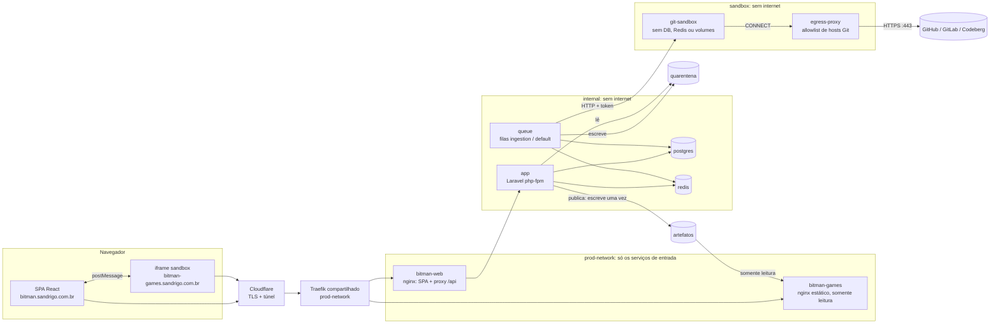
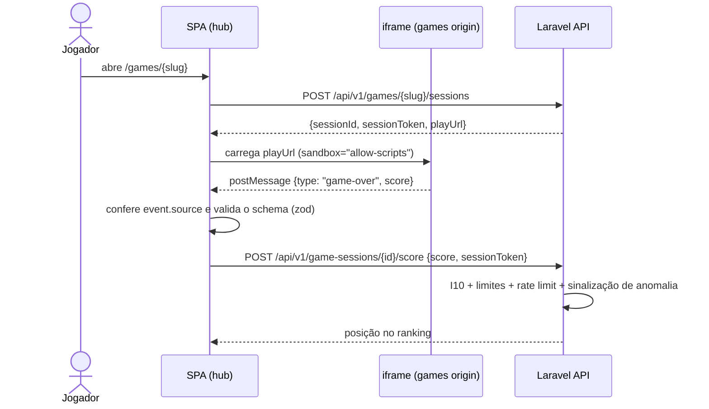
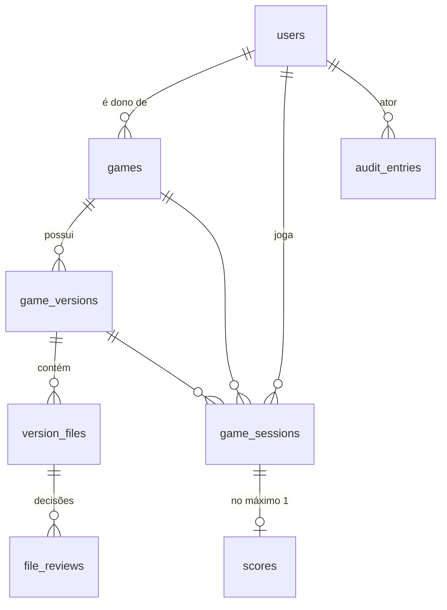

# Arquitetura

Visão técnica do Bitman. As regras de negócio estão em [dominio.md](dominio.md)
e as ameaças e mitigações em [seguranca.md](seguranca.md).

## Visão geral

Monólito modular em Laravel 13 (API) com SPA em React + TypeScript. Três peças
ficam **fora** do monólito por motivo de segurança:

1. **git-sandbox**: o único componente que fala com repositórios Git externos.
2. **egress-proxy**: a única saída de rede da sandbox, que libera apenas os hosts Git permitidos.
3. **games origin**: servidor estático em outro host, que só serve artefatos publicados.

Nome do projeto na infraestrutura: **`bitman`** (prefixo de containers, routers e services).



## Infraestrutura

Ela segue as convenções do servidor compartilhado ([ADR 0010](adr/0010-infraestrutura-homelab.md)):

- **Borda:** navegador → Cloudflare (o TLS termina aqui) → túnel → Traefik v3 compartilhado → `bitman-web` / `bitman-games`.
  Não há `ports:`, nem certificados, nem outro proxy de borda.
- **Domínios:** hub em `bitman.sandrigo.com.br`, jogos em `bitman-games.sandrigo.com.br`. São subdomínios de
  primeiro nível porque o certificado universal da Cloudflare cobre só `*.sandrigo.com.br`. O túnel já
  encaminha `*.sandrigo.com.br` ao Traefik, que roteia pelo `Host` declarado nas labels dos containers.
  **Não há configuração na Cloudflare.**
- **Um ambiente só:** não existe ambiente de desenvolvimento separado. O projeto é desenvolvido direto no
  servidor, em `/mnt/Dados/prog/prod/bitman`, num único `docker-compose.yml` (`name: bitman`), sempre
  operado pelo `Makefile`. A produção roda imagens geradas de um commit (`make release`), e o desenvolvimento usa os
  serviços do perfil `dev` com bind mount: editar aqui não muda a produção ([implantacao.md](implantacao.md)).
  Até o lançamento vale o **modo pré-lançamento** (abaixo).
- **Dados:** volumes Docker nomeados (PostgreSQL, Redis, quarentena, artefatos, thumbnails e `node_modules` do frontend), nunca
  bind mount em `/mnt/Dados` (é NTFS, onde `chmod` não tem efeito). Os segredos ficam no `.env` da raiz, ignorado
  pelo git e entregue aos containers por `env_file` e, montado como `backend/.env`, somente leitura (padrão Carphook).
  Só o `.env.example` é versionado.
- **Testes:** rodam no serviço `test` (perfil `dev`, imagem `bitman-php:dev`), no banco `bitman_test` do mesmo PostgreSQL. O `phpunit.xml` força esse banco,
  e um teste-trava (`tests/Feature/TestEnvironmentTest.php`) falha se algum dia apontar para outro.
- **Deploy:** GitHub Actions (CI verde em `main`) → `POST https://deploy.sandrigo.com.br/hooks/deploy-bitman`
  → `deploy-hub/scripts/deploy-bitman.sh` (executado só depois que o Rafael aprova o hash) → `make release REF=origin/main`.
  Detalhes e ativação em [implantacao.md](implantacao.md).

### Modo pré-lançamento

Enquanto não há usuários reais:

| Item | Pré-lançamento | No lançamento (ver [plano.md](plano.md#checklist-de-lançamento)) |
|---|---|---|
| Indexação do hub | `X-Robots-Tag: noindex` no Traefik e `noindex` no `index.html` | Removidos |

O hub e o host de jogos são públicos (a autenticação básica do hub foi retirada em 13/10/2026). O host de jogos
só serve jogos publicados, em caminhos UUID não adivinháveis, com `noindex`.

## Containers

| Serviço | Papel | Redes | Observações |
|---|---|---|---|
| `bitman-web` | nginx (imagem `bitman-web:release`): serve a SPA compilada na imagem e as thumbnails (`/media/thumbnails`, volume `media` somente leitura) e encaminha `/api`, `/sanctum` e `/up` para o php-fpm | prod-network, internal | SPA e API na **mesma origem** (cookies Sanctum sem CORS). CSP do hub e IP real via `CF-Connecting-IP` |
| `bitman-games` | nginx estático da origem de jogos | prod-network | Monta o subdiretório `served` do volume de artefatos, somente leitura. Só serve `/{uuid}/{index.html,style.css,game.js}`; o resto é 404 |
| `app` | Laravel (php-fpm 8.5) | internal, egress | Imagem `bitman-php:release` (código embutido, construída só por este serviço) |
| `queue` | `queue:work` (filas `ingestion` e `default`) | internal, egress, sandbox | É o único que fala com a sandbox. Roda como `www-data` |
| `scheduler` | `schedule:work` | internal, egress | Roda como `www-data` |
| `test` | Perfil `dev`: composer, Pest, Pint e Larastan sobre `./backend` montado | internal, egress | Imagem `bitman-php:dev`. Só roda sob demanda (`make test-back`, `make composer`) |
| `frontend` | Perfil `dev`: npm, Vitest, oxlint e tsc sobre `./frontend` montado | egress | `node_modules` em volume próprio (binários da imagem alpine). Só roda sob demanda |
| `postgres` | PostgreSQL 17 (bancos `bitman` e `bitman_test`) | internal | — |
| `redis` | Redis 8.2 com senha: fila, cache, sessão e rate limit | internal | — |
| `git-sandbox` | `POST /fetch` (token): clone bare raso e manifesto (commit, árvore, blobs pedidos) | sandbox | Usuário não-root, rootfs read-only, `tmpfs` de 256 MB, `cap_drop: ALL`, `no-new-privileges`, limites de CPU, memória e pids |
| `egress-proxy` | tinyproxy: só `CONNECT` na 443 para `github.com`, `gitlab.com` e `codeberg.org` | sandbox, egress | O único caminho da sandbox para a internet. Bloqueia a LAN e os outros projetos |

Os containers ficam com os nomes `bitman-<serviço>-1`. As redes do projeto são `internal` (`internal: true`: banco e
cache sem internet), `egress` (saída para a internet: SMTP e npm) e `sandbox` (`internal: true`, com saída só pelo proxy).
Só `bitman-web` e `bitman-games` entram na `prod-network`. Todo container tem limite de CPU e memória.

**Atrás da Cloudflare:** o nginx `bitman-web` obtém o IP real do cliente por `CF-Connecting-IP` (`set_real_ip_from` só para
redes privadas) e o repassa ao PHP como `REMOTE_ADDR`, o que é essencial para o rate limit. Como o acesso público é sempre
HTTPS e o trecho Traefik → nginx é HTTP interno, o nginx informa `HTTPS=on` ao PHP.

## Backend: módulos e camadas

```
backend/app/
├── Modules/
│   ├── Identity/
│   ├── Catalog/
│   ├── Versioning/
│   ├── Ingestion/
│   ├── Play/
│   └── Audit/
└── Shared/              # kernel compartilhado: eventos de domínio, exceção base, RepositoryUrl e GitRef (Domain/Git)
```

Cada módulo usa as mesmas camadas, e só cria as que precisa:

```
Modules/Versioning/
├── Domain/           # Modelos-agregado, enums de estado, value objects, eventos, exceções, portas (interfaces)
├── Application/      # Actions (um caso de uso = uma classe), DTOs de entrada
├── Infrastructure/   # Adaptadores das portas (sandbox HTTP, filesystem), jobs, listeners
└── Http/             # Controllers finos, FormRequests, API Resources, rotas do módulo
```

### Regra de dependência

```
Http ──► Application ──► Domain ◄── Infrastructure
```

- `Domain` não conhece `Http`, `Infrastructure`, `Request`, `Auth` nem facades de I/O.
- `Application` depende do `Domain` e das **portas** declaradas nele; nunca de um adaptador concreto.
- Um módulo só usa de outro módulo os seus **eventos**, **IDs** e **contratos públicos**
  (ex.: `Catalog` reage a `VersionPublished`; ele não altera `GameVersion`).
- As regras são verificadas por **testes de arquitetura do Pest** (`tests/Arch`), que
  quebram o build quando violadas.

### Decisões de design (e por que são simples)

| Tema | Decisão | Motivo |
|---|---|---|
| Persistência | Modelos Eloquent **são** os agregados. Não há Repository Pattern sobre o Eloquent | KISS: o Eloquent já é a camada de persistência e a abstração extra não paga o custo |
| Transições de estado | Apenas por métodos de intenção (`$version->approveCommit($admin, $reason)`), que validam a transição e emitem o evento. `status` não é *fillable* | Mantém as invariantes dentro do agregado (padrão State via enum com mapa de transições) |
| Portas e adaptadores | Só onde há I/O externo ou não determinístico: `GitSourceFetcher`, `QuarantineStore`, `ArtifactStore`, `ThumbnailProcessor`, `Clock` | Permite testar o domínio sem rede nem disco e trocar a infraestrutura depois |
| Casos de uso | Actions invocáveis (`AuthorizeImport`, `ApproveCommit`, `ApproveFile`, `PublishVersion`, `SubmitScore`...) | SRP. Qualquer entrada (HTTP, CLI, job) passa pelo mesmo caminho |
| Autorização | Gate **dentro da Action** (não só no controller): permissão do enum `Permission`, ou Policy quando depende do recurso. Rotas admin sempre no grupo `/api/v1/admin` | Uma nova rota não consegue "esquecer" a autorização (I12) |
| Política de repositório | Lista de regras `RepositoryRule` (Specification) compostas em `RepositoryPolicy` | Open/Closed: uma nova regra é uma nova classe, testada isoladamente |
| Eventos de domínio | O agregado registra (`RecordsDomainEvents`); a Action persiste e publica (`DomainEventPublisher`) dentro da transação | O domínio não depende do dispatcher, e os listeners síncronos participam do mesmo commit |
| Auditoria | Eventos que implementam `Audit\Domain\Auditable` → listener **síncrono** que grava `audit_entries` na mesma transação | A auditoria não se perde se a fila cair (I11), e os módulos não dependem do Audit além do contrato |
| Erros de domínio | Exceções `BusinessRuleViolation` com mensagem em pt-BR → HTTP 422, mapeadas só em `bootstrap/app.php` | Um único ponto de tradução domínio → HTTP |
| IDs | ULID nas entidades expostas; UUID v4 em `publicId` do artefato | Não enumeráveis e ordenáveis |
| API | JSON REST, `/api/v1`, respostas com API Resources. OpenAPI gerada a partir do código (Scramble) | Contrato documentado sem manutenção manual |

### Consulta da auditoria

`GET /api/v1/admin/audit-entries` (permissão `audit.view`) aceita filtros combináveis: `subject_type` + `subject_id`,
`action`, `actor_id` e as duas **linhas do tempo**:

- `game_id`: o jogo, todas as versões dele (`game_version`) e os scores dele (`score`, pelo `game_id` do contexto);
- `user_id`: o que aconteceu com o usuário (`user`) e tudo o que ele fez como ator.

Os filtros são validados (`alpha_dash` ASCII e `regex` na ação) e viram parâmetros de consulta, nunca texto de SQL.
Cada pergunta da seção *Auditoria* do [contexto](contexto-do-produto.md#auditoria) tem resposta na linha do tempo do
jogo (`/admin/auditoria?game_id=…`, também ligada da página do jogo e das submissões):

| Pergunta | Onde está |
|---|---|
| Quem submeteu, quem informou a URL e qual URL | `catalog.game-submitted`: ator e `repository_url` |
| Quem autorizou ou rejeitou a execução Git | `versioning.import-authorized` / `import-rejected`: ator, data e motivo |
| Quando foi o fetch e qual commit | `versioning.repository-fetched`: data e `commit` |
| Quem aprovou o commit | `versioning.commit-approved` / `commit-rejected` |
| Quais arquivos foram encontrados | Detalhe da versão (relatório e arquivos); cada decisão em `versioning.file-*` |
| Qual arquivo, quem aprovou, com qual hash e quando | `versioning.file-approved`: `path`, `sha256`, ator e data |
| Quem rejeitou o quê | `versioning.*-rejected`, com motivo; filtro por ação e por ator |
| Qual versão foi publicada e qual URI | `versioning.version-published`: `number`, `public_id` (a URI) e o hash de cada arquivo |

O teste `EndToEndPublicationTest` responde cada uma dessas perguntas pela API, a partir do fluxo completo.

### API e autenticação

- Rotas em `/api/v1`. Cada módulo declara as suas em `Http/routes.php` (públicas) e `Http/admin-routes.php`
  (administrativas). O `routes/api.php` inclui as administrativas **só** dentro do grupo
  `/api/v1/admin` (`auth:sanctum` + `verified` + `role:admin`).
- Autenticação: Fortify headless em `/api/v1/auth` (`register`, `login`, `logout`, `forgot-password`, `reset-password`,
  `email/verify/{id}/{hash}`, `email/verification-notification`), mais `GET /api/v1/me` ([ADR 0011](adr/0011-autenticacao-com-fortify.md)).
- A SPA busca `/sanctum/csrf-cookie` antes da primeira requisição que altera estado e repete uma vez em caso de 419.
- Os e-mails saem pela fila `default`, com links para as rotas da SPA (`/verificar-email?link=…`, `/redefinir-senha?token=…`).
- Catálogo: `POST /api/v1/games` (submissão, multipart, `games.submit`) e `GET /api/v1/me/games`; no admin,
  `GET /api/v1/admin/submissions` e `PATCH /api/v1/admin/games/{id}/slug` (`games.manage`).
- Versões (Fase 3, `versions.authorize-import`): `GET /api/v1/admin/versions?status=`, `GET /api/v1/admin/versions/{id}`,
  `POST …/versions/{id}/authorize-import`, `POST …/versions/{id}/reject-import` (`reason`) e `POST /api/v1/admin/games/{id}/versions`
  (nova importação; no máximo uma versão em andamento por jogo, garantida por índice parcial).
- Comunicação entre módulos: o Versioning escuta `Catalog\Domain\Events\GameSubmitted` (listener síncrono, mesma transação)
  para criar a versão 1. `ImportAuthorized` enfileira o `FetchRepositoryJob` depois do commit. O Versioning usa do Ingestion só o
  Domain (`GitSourceFetcher`, `RepositoryPolicy`, `ValidationReport`). Nenhum módulo altera tabelas de outro.

## Fluxos principais

### Ingestão (Portão 0 → Portão 1)

```mermaid
sequenceDiagram
    actor Admin
    participant API as Laravel API
    participant Q as Worker (ingestion)
    participant S as git-sandbox
    participant G as Host Git

    Admin->>API: POST /admin/versions/{id}/authorize-import
    API->>API: Policy + transição import_requested → fetching + AuditEntry
    API->>Q: FetchRepositoryJob(versionId)
    Q->>S: POST /fetch {url, ref} (já validados pelos value objects)
    S->>G: git clone --bare --depth=1 --filter=blob:limit (somente HTTPS, sem redirects)
    S-->>Q: manifesto: commitSha, árvore (path, modo, tamanho), blobs permitidos (ou só um código de erro)
    Q->>Q: Revalida tudo (zero trust também na sandbox): RepositoryPolicy → ValidationReport
    alt violação bloqueante
        Q->>API: transição fetching → validation_failed (nada na quarentena; o dono vê o motivo e reenvia)
    else sem violações
        Q->>Q: Grava blobs na quarentena; calcula SHA-256; diff com a versão publicada
        Q->>API: transição fetching → awaiting_commit_review
    end
    Admin->>API: POST /admin/versions/{id}/approve-commit
```

### Publicação

`PublishVersion` (em uma transação, com a versão e o jogo travados): verifica I6 lendo cada blob da
quarentena e recalculando o SHA-256 → grava em `artifacts/archive/{gameId}/v{n}/` (write-once: `mkdir` e
`fopen 'x'`, I7) → monta `artifacts/served/{publicId}/` num diretório de staging e o publica com um
`rename` atômico (diretórios `0755`, arquivos `0644`, legíveis pelo nginx de jogos) → a versão anterior vai
para `superseded` e sai do ar → a nova vira `published` → `VersionPublished` (o Catalog aponta o jogo para ela).
Se algo falha antes do commit, o archive e o diretório servido desta tentativa são desfeitos. Depois do
commit, a quarentena da versão é descartada (o conteúdo está no archive).

Tirar do ar (retirada, bloqueio, versão substituída) acontece **dentro** da transação: numa falha, o jogo
fica fora do ar, nunca "retirado no banco, mas servido" (J6). Voltar ao ar (desbloqueio) acontece **depois**
do commit, a partir do archive e conferindo os hashes de novo; uma falha aí deixa o jogo fora do ar e é
reportada (o detalhe do jogo no admin mostra se a versão está sendo servida). O `archive` é permanente.

**Reconciliação (M12).** `bitman:reconcile-served` roda de hora em hora no `scheduler`. Ele confere o `served/`
contra as versões no ar (jogo `published` e versão `published`):

- um diretório servido sem versão no ar sai do ar (J6);
- uma versão no ar sem diretório, ou com conteúdo diferente do aprovado, volta a ser servida a partir do archive,
  com os hashes conferidos de novo (`ServeArchivedVersion`, I6);
- se o archive não confere ou falta, a versão continua fora do ar.

Cada correção gera um log `served.removed`, `served.restored` ou `served.replaced` (warning). Uma falha gera
`served.restore_failed` (error), e o comando sai com código 1.

### Partida e score



O jogo **não tem acesso à rede** (`connect-src 'none'`). Toda comunicação passa pela
SPA. Contrato para desenvolvedores: [protocolo-do-jogo.md](protocolo-do-jogo.md).

- `POST /games/{slug}/sessions` (login + e-mail confirmado, `throttle:game-sessions`) responde `201` com
  `Cache-Control: no-store`. A `play_url` é a da versão da sessão; a SPA a confere com `isPlayUrl` antes de pôr no iframe.
- `POST /game-sessions/{id}/score` (`throttle:score-submissions`): a transação trava a sessão (`FOR UPDATE`), confere
  token, estado, prazo e duração, calcula a sinalização sobre a distribuição atual do jogo e grava o `Score`. Envios
  concorrentes esperam o lock e recebem 409; o `unique(game_session_id)` cobre o que escapar.
- `GET /games/{slug}/leaderboard` (público) vem do `CachedLeaderboard` (Redis, TTL de 10 min), invalidado **depois
  do commit** de `ScoreRecorded`, `ScoreHidden` e `ScoreRestored`. A posição do jogador na resposta do envio é lida
  do banco. `GET /me/scores` é o histórico do jogador.
- O resultado aparece num painel do hub sobre o iframe (`ResultPanel`): enviando, registrado (posição e recorde),
  recusado ou inválido. O painel é do hub, fora do iframe, e o jogo não consegue imitá-lo nem escondê-lo.

### Partida de visitante

Quem não tem conta ou ainda não confirmou o e-mail joga numa `GuestPlay` ([dominio.md](dominio.md#guestplay-play)).

1. `POST /games/{slug}/guest-plays` (público, 30/h por IP) abre a partida, com token e `play_url` como na sessão.
2. No `game-over`, `POST /guest-plays/{id}/score` (público, 20/min por IP) guarda o score pendente. O painel do
   Bitman avisa que a pessoa não está logada e oferece **Criar conta e salvar** e **Entrar e salvar**. Para
   e-mail não confirmado, oferece **Confirmar e-mail e salvar**.
3. A SPA guarda `{id, token, jogo, valor, prazo}` no `localStorage` do hub (`pendingScore.ts`). Assim o score
   sobrevive ao login, ao cadastro e à confirmação do e-mail, que abre outra aba. Sem storage, ele fica na memória da aba.
4. Quando a conta está confirmada, o `PendingScoreSaver` (no layout, em qualquer página) chama
   `POST /guest-plays/{id}/claim` (login + e-mail confirmado) e mostra o aviso "Score salvo", com a posição e um link
   para o ranking. Uma recusa definitiva (4xx) apaga o pendente; uma falha de rede deixa para a próxima vez.

## Frontend

React 19 + TypeScript (strict) + Vite.

| Necessidade | Escolha |
|---|---|
| Rotas | React Router |
| Estado do servidor | TanStack Query |
| Validação de respostas da API e de mensagens do iframe | Zod (zero trust também nas fronteiras do cliente) |
| Formulários | React Hook Form + Zod |
| Estilo | Tailwind CSS |
| Testes | Vitest + Testing Library + MSW. Playwright para os fluxos críticos E2E |
| Qualidade | oxlint + `tsc --noEmit` |

Organização por feature, com dependências apenas `features → shared`:

```
frontend/src/
├── app/            # roteamento, providers, layouts, guards de rota por role
├── features/
│   ├── auth/
│   ├── catalog/    # listagem e página do jogo
│   ├── play/       # host do iframe, bridge postMessage, sessão
│   ├── ranking/
│   ├── submissions/  # área do desenvolvedor
│   └── admin/      # filas de revisão, portões, visualizador de arquivos, auditoria
└── shared/         # cliente HTTP, componentes de UI, utilitários
```

Os guards de rota no frontend servem só para UX. **A autorização real é sempre do backend.**

## Dados (visão inicial)



Restrições no banco reforçam o domínio: `unique(game_id, number)`,
`unique(scores.game_session_id)`, índice parcial que garante uma única versão
`published` por jogo e um trigger no PostgreSQL que impede `UPDATE`/`DELETE` em
`audit_entries` e `file_reviews`.
