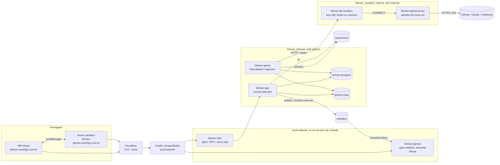
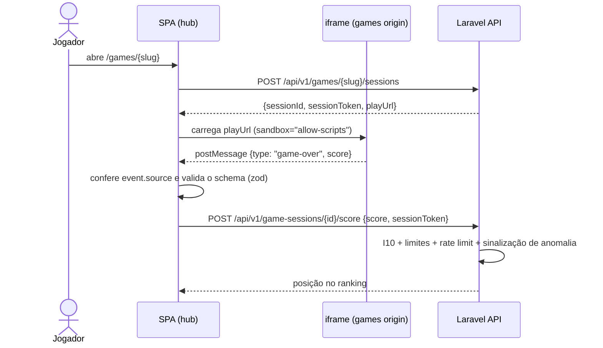
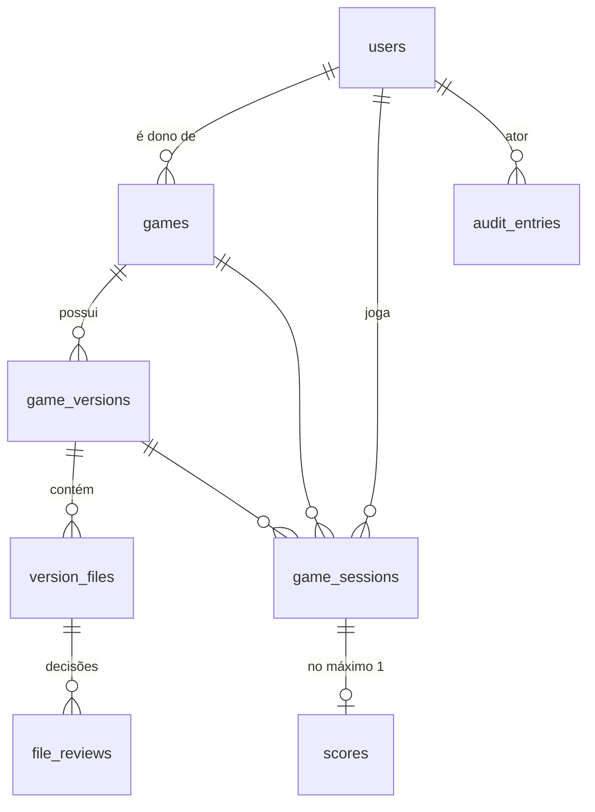

# Arquitetura

Visão técnica do Bitman. As regras de negócio estão em [dominio.md](dominio.md)
e as ameaças e mitigações em [seguranca.md](seguranca.md).

## Visão geral

Monólito modular em Laravel 13 (API) com SPA em React + TypeScript. Três peças
ficam **fora** do monólito por motivo de segurança:

1. **git-sandbox**: o único componente que fala com repositórios Git externos.
2. **egress-proxy**: a única saída de rede da sandbox, que libera apenas os hosts Git permitidos.
3. **games origin**: servidor estático em outro host, que só serve artefatos publicados.

Nome do projeto na infraestrutura: **`bitman`** (prefixo de containers, routers e services).



## Infraestrutura

Ela segue as convenções do servidor compartilhado ([ADR 0010](adr/0010-infraestrutura-homelab.md)):

- **Borda:** navegador → Cloudflare (o TLS termina aqui) → túnel → Traefik v3 compartilhado → `bitman-web` / `bitman-games`.
  Não há `ports:` em produção, nem certificados, nem outro proxy de borda.
- **Domínios:** hub em `bitman.sandrigo.com.br`, jogos em `bitman-games.sandrigo.com.br`. São subdomínios de
  primeiro nível porque o certificado universal da Cloudflare cobre só `*.sandrigo.com.br`. O túnel já
  encaminha `*.sandrigo.com.br` ao Traefik, que roteia pelo `Host` declarado nas labels dos containers.
  **Não há configuração na Cloudflare.**
- **Compose:** `docker-compose.base.yml` (serviços), `docker-compose.yml` (dev: portas locais, Mailpit,
  Vite) e `docker-compose.prod.yml` (sem portas, labels do Traefik, `prod-network` externa).
- **Dados:** volumes Docker nomeados (PostgreSQL, Redis, quarentena e artefatos), nunca bind mount em `/mnt/Dados`
  (é NTFS, onde `chmod` não tem efeito). Os segredos de produção ficam em `~/.local/share/bitman/`, fora do repositório.
- **Deploy:** GitHub Actions (CI verde em `main`) → `POST https://deploy.sandrigo.com.br/hooks/deploy-bitman`
  → `deploy-hub/scripts/deploy-bitman.sh` (executado só depois que o Rafael aprova o hash).

## Containers

| Serviço | Papel | Redes | Observações |
|---|---|---|---|
| `bitman-web` | nginx: serve o build da SPA e faz proxy de `/api` e `/sanctum` para `bitman-app` | prod-network, internal | SPA e API na **mesma origem** (cookies Sanctum sem CORS). Healthcheck em `127.0.0.1` |
| `bitman-games` | nginx estático da origem de jogos | prod-network | Monta `artefatos/served` como somente leitura e define os headers de segurança. Não fala com nenhum outro serviço |
| `bitman-app` | Laravel (php-fpm 8.5) | internal | — |
| `bitman-queue` | `queue:work` (filas `default` e `ingestion`) | internal, sandbox | É o único que fala com a sandbox |
| `bitman-scheduler` | `schedule:work` (expirar sessões, limpar quarentena) | internal | — |
| `bitman-postgres` | Banco principal | internal | — |
| `bitman-redis` | Fila, cache e rate limit | internal | — |
| `bitman-git-sandbox` | Busca repositórios e devolve um manifesto | sandbox | Usuário não-root, rootfs read-only, `tmpfs` limitado, `cap_drop: ALL`, `no-new-privileges`, limites de CPU, memória e pids |
| `bitman-egress-proxy` | Proxy HTTP `CONNECT` que só permite `github.com`, `gitlab.com` e `codeberg.org` na porta 443 | sandbox, egress | Bloqueia a rede local do servidor e os outros projetos. O único caminho da sandbox para a internet |
| `bitman-mailpit` | Captura de e-mails (só em dev) | internal | — |

Redes do projeto: `bitman_internal` (`internal: true`), `bitman_sandbox` (`internal: true`, sem rota
para a internet) e `bitman_egress` (bridge com saída). Só `bitman-web` e `bitman-games` entram na `prod-network`.

**Desenvolvimento** (mesma máquina, portas só em `127.0.0.1`): hub em `http://localhost:8200`
(Vite em `8201`, com proxy de `/api` e `/sanctum`), jogos em `http://127.0.0.1:8202`, Mailpit em
`http://localhost:8203`, PostgreSQL em `3200` e Redis em `3201`. Hub e jogos usam hosts diferentes
(`localhost` × `127.0.0.1`), então os cookies do hub nunca são enviados à origem de jogos.

**Atrás da Cloudflare:** o Laravel confia apenas no proxy da rede interna (`TrustProxies`) e obtém o IP
real do cliente via `CF-Connecting-IP` (no nginx, com `set_real_ip_from` restrito à rede do Traefik). Isso é
essencial para o rate limit. O esquema `https` chega por `X-Forwarded-Proto`.

## Backend: módulos e camadas

```
backend/app/
├── Modules/
│   ├── Identity/
│   ├── Catalog/
│   ├── Versioning/
│   ├── Ingestion/
│   ├── Play/
│   └── Audit/
└── Shared/              # kernel compartilhado: Clock, Sha256, exceções base
```

Cada módulo usa as mesmas camadas, e só cria as que precisa:

```
Modules/Versioning/
├── Domain/           # Modelos-agregado, enums de estado, value objects, eventos, exceções, portas (interfaces)
├── Application/      # Actions (um caso de uso = uma classe), DTOs de entrada
├── Infrastructure/   # Adaptadores das portas (sandbox HTTP, filesystem), jobs, listeners
└── Http/             # Controllers finos, FormRequests, API Resources, rotas do módulo
```

### Regra de dependência

```
Http ──► Application ──► Domain ◄── Infrastructure
```

- `Domain` não conhece `Http`, `Infrastructure`, `Request`, `Auth` nem facades de I/O.
- `Application` depende do `Domain` e das **portas** declaradas nele; nunca de um adaptador concreto.
- Um módulo só usa de outro módulo os seus **eventos**, **IDs** e **contratos públicos**
  (ex.: `Catalog` reage a `VersionPublished`; ele não altera `GameVersion`).
- As regras são verificadas por **testes de arquitetura do Pest** (`tests/Arch`), que
  quebram o build quando violadas.

### Decisões de design (e por que são simples)

| Tema | Decisão | Motivo |
|---|---|---|
| Persistência | Modelos Eloquent **são** os agregados. Não há Repository Pattern sobre o Eloquent | KISS: o Eloquent já é a camada de persistência e a abstração extra não paga o custo |
| Transições de estado | Apenas por métodos de intenção (`$version->approveCommit($admin, $reason)`), que validam a transição e emitem o evento. `status` não é *fillable* | Mantém as invariantes dentro do agregado (padrão State via enum com mapa de transições) |
| Portas e adaptadores | Só onde há I/O externo ou não determinístico: `GitSourceFetcher`, `QuarantineStore`, `ArtifactStore`, `ThumbnailProcessor`, `Clock` | Permite testar o domínio sem rede nem disco e trocar a infraestrutura depois |
| Casos de uso | Actions invocáveis (`AuthorizeImport`, `ApproveCommit`, `ApproveFile`, `PublishVersion`, `SubmitScore`...) | SRP. Qualquer entrada (HTTP, CLI, job) passa pelo mesmo caminho |
| Autorização | Policies do Laravel, chamadas **dentro da Action** (não só no controller), mais roles/permissions (spatie) | Uma nova rota não consegue "esquecer" a autorização (I12) |
| Política de repositório | Lista de regras `RepositoryRule` (Specification) compostas em `RepositoryPolicy` | Open/Closed: uma nova regra é uma nova classe, testada isoladamente |
| Auditoria | Eventos de domínio → listener **síncrono** que grava `audit_entries` na mesma transação | A auditoria não se perde se a fila cair (I11) |
| IDs | ULID nas entidades expostas; UUID v4 em `publicId` do artefato | Não enumeráveis e ordenáveis |
| API | JSON REST, `/api/v1`, respostas com API Resources. OpenAPI gerada a partir do código (Scramble) | Contrato documentado sem manutenção manual |

## Fluxos principais

### Ingestão (Portão 0 → Portão 1)

```mermaid
sequenceDiagram
    actor Admin
    participant API as Laravel API
    participant Q as Worker (ingestion)
    participant S as git-sandbox
    participant G as Host Git

    Admin->>API: POST /admin/versions/{id}/authorize-import
    API->>API: Policy + transição import_requested → fetching + AuditEntry
    API->>Q: FetchRepositoryJob(versionId)
    Q->>S: POST /fetch {url, ref} (já validados pelos value objects)
    S->>G: git ls-remote / fetch --depth=1 (somente HTTPS, sem redirects)
    S-->>Q: manifesto: commitSha, árvore (path, modo, tamanho), blobs permitidos
    Q->>Q: Revalida tudo (zero trust também na sandbox): RepositoryPolicy → ValidationReport
    Q->>Q: Grava blobs na quarentena; calcula SHA-256; diff com a versão publicada
    Q->>API: transição fetching → awaiting_commit_review
    Admin->>API: POST /admin/versions/{id}/approve-commit
```

### Publicação

`PublishVersion` (em uma transação): verifica I6 lendo cada blob da quarentena e
recalculando o SHA-256 → grava em `artefatos/archive/{gameId}/versions/{n}/` (write-once)
→ copia para `artefatos/served/{publicId}/` → marca a versão anterior como `superseded`
e remove o diretório servido dela → emite `VersionPublished`. Bloquear um jogo ou
retirar uma versão remove o diretório `served` correspondente. O `archive` é permanente.

### Partida e score



O jogo **não tem acesso à rede** (`connect-src 'none'`). Toda comunicação passa pela
SPA. Contrato para desenvolvedores: [protocolo-do-jogo.md](protocolo-do-jogo.md).

## Frontend

React 19 + TypeScript (strict) + Vite.

| Necessidade | Escolha |
|---|---|
| Rotas | React Router |
| Estado do servidor | TanStack Query |
| Validação de respostas da API e de mensagens do iframe | Zod (zero trust também nas fronteiras do cliente) |
| Formulários | React Hook Form + Zod |
| Estilo | Tailwind CSS |
| Testes | Vitest + Testing Library + MSW. Playwright para os fluxos críticos E2E |
| Qualidade | oxlint + `tsc --noEmit` |

Organização por feature, com dependências apenas `features → shared`:

```
frontend/src/
├── app/            # roteamento, providers, layouts, guards de rota por role
├── features/
│   ├── auth/
│   ├── catalog/    # listagem e página do jogo
│   ├── play/       # host do iframe, bridge postMessage, sessão
│   ├── ranking/
│   ├── submissions/  # área do desenvolvedor
│   └── admin/      # filas de revisão, portões, visualizador de arquivos, auditoria
└── shared/         # cliente HTTP, componentes de UI, utilitários
```

Os guards de rota no frontend servem só para UX. **A autorização real é sempre do backend.**

## Dados (visão inicial)



Restrições no banco reforçam o domínio: `unique(game_id, number)`,
`unique(scores.game_session_id)`, índice parcial que garante uma única versão
`published` por jogo e um trigger no PostgreSQL que impede `UPDATE`/`DELETE` em
`audit_entries` e `file_reviews`.
