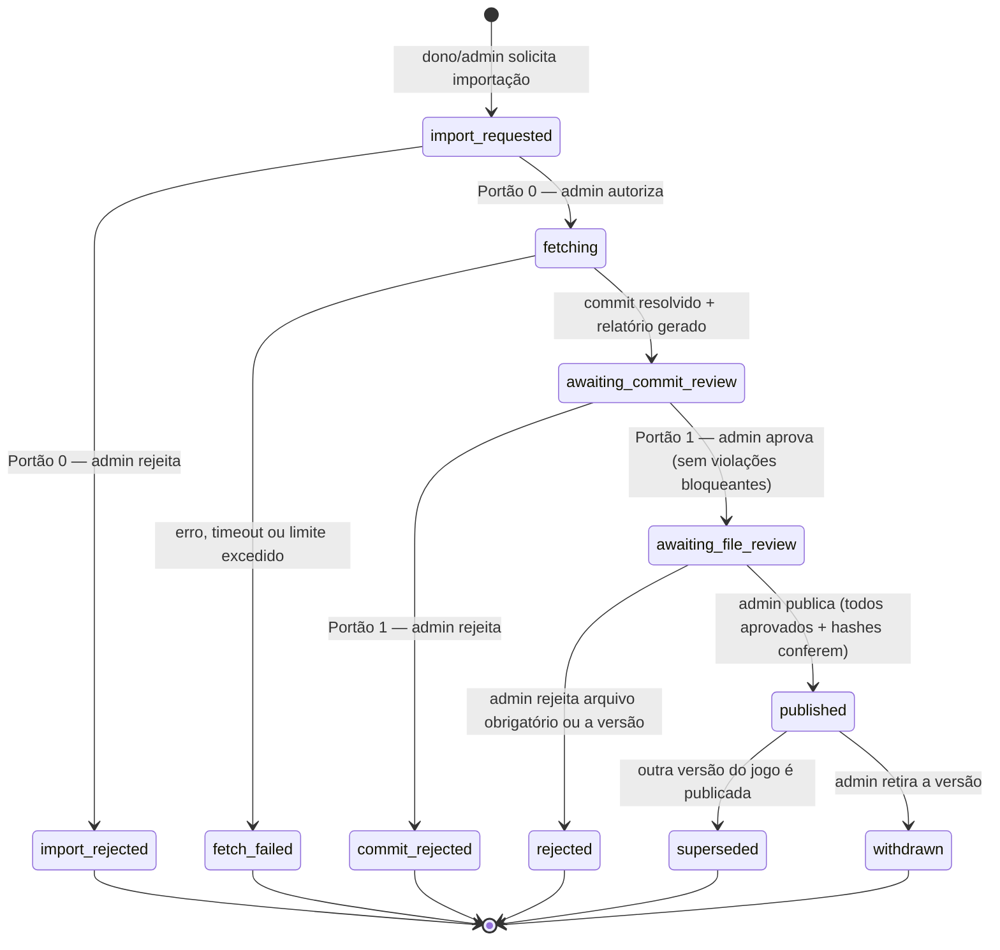

# Domínio

Modelo de domínio do Bitman: a linguagem que usamos, os agregados, os estados
e as regras que nunca podem ser quebradas. Cada invariante listada aqui **tem
pelo menos um teste automatizado** que a referencia pelo código (ex.: `I5`).

## Linguagem ubíqua

O código é escrito em inglês e a interface e a documentação em português. Esta
tabela é o dicionário entre os dois. Não invente sinônimos.

| Termo (PT) | Código | Significado |
|---|---|---|
| Jogo | `Game` | O produto exibido no catálogo. Tem slug, metadados e no máximo uma versão publicada. |
| Dono do jogo | `owner` | Usuário com role `developer` que submeteu o jogo. Só submete; nunca aprova. |
| Autor | `authorName` | Nome exibido como criador. É texto livre e pode diferir do dono. |
| Versão | `GameVersion` | Um estado do repositório (commit) importado para análise. Numerada sequencialmente por jogo. |
| Solicitação de importação | `GameVersion` em `import_requested` | Pedido para buscar o repositório. Ainda não houve nenhum acesso à rede. |
| Portão 0 — Autorização Git | `authorizeImport` / `rejectImport` | O admin autoriza o sistema a acessar o repositório. |
| Portão 1 — Aprovação do commit | `approveCommit` / `rejectCommit` | O admin confirma que *este commit* é a fonte a analisar. |
| Portão 2 — Aprovação de arquivo | `approveFile` / `rejectFile` | O admin aprova o conteúdo exato (hash) de um arquivo. |
| Publicação | `publish` | O admin torna a versão executável, depois de verificados os hashes. |
| Relatório de validação | `ValidationReport` | Resultado das regras de repositório: violações bloqueantes e arquivos ignorados. |
| Arquivo da versão | `VersionFile` | Um arquivo candidato (path permitido + SHA-256 + tamanho) de uma versão. |
| Quarentena | `QuarantineStore` | Armazenamento dos blobs ainda não publicados. Nunca é servido. |
| Artefato | `ArtifactStore` | Cópia imutável dos arquivos de uma versão publicada. |
| Origem de jogos | `games origin` | Host separado (`bitman-games.sandrigo.com.br`) que serve apenas artefatos publicados. |
| Sessão de jogo | `GameSession` | Uma partida iniciada por um usuário numa versão publicada. Aceita no máximo um score. |
| Pontuação | `Score` | Resultado enviado ao final de uma sessão. |
| Ranking | `Leaderboard` | O melhor score de cada jogador em um jogo. |
| Registro de auditoria | `AuditEntry` | Fato imutável: quem fez o quê, quando, sobre qual estado. |

## Contextos (bounded contexts)

| Contexto | Responsabilidade | Tipo |
|---|---|---|
| **Versioning** | Ciclo de vida da versão: portões, arquivos, hashes, publicação | Núcleo (core) |
| **Ingestion** | Obter o repositório via sandbox e aplicar a política de repositório | Suporte |
| **Catalog** | Jogo, submissão, slug, thumbnail, listagem pública, bloqueio | Suporte |
| **Play** | Sessões, scores e ranking | Suporte |
| **Identity** | Usuários, autenticação, roles e permissões | Genérico |
| **Audit** | Registro append-only das ações | Genérico |

Os contextos se comunicam por **eventos de domínio** e por **IDs**, nunca alterando
diretamente os dados de outro contexto. Detalhes em [arquitetura.md](arquitetura.md).

## Agregados

### User (Identity)

- Campos: `id` (ULID), `name`, `email` (único, em minúsculas), `email_verified_at` e a senha (hash).
- Toda conta nasce com a role `player`, que é permanente.
- `grantRole(role, actor)` / `revokeRole(role, actor)` são os únicos meios de mudar roles. Eles recusam role repetida,
  remoção de `player`, remoção de role ausente e roles acima de `player` para quem não confirmou o e-mail.
  Cada mudança registra `RoleGranted` / `RoleRevoked`, que são auditáveis.
- Pelo painel só se promove ou rebaixa `developer`. `admin` só é concedido pelo console (`user:grant-role`).

| Role | Permissões |
|---|---|
| `player` | — (joga e aparece nos rankings, com e-mail confirmado) |
| `developer` | `games.submit` |
| `admin` | todas (`games.submit`, `games.manage`, `versions.authorize-import`, `users.manage-roles`, `audit.view` e as das próximas fases) |

### Game (Catalog)

- Campos: `id` (ULID), `slug` (único), `name`, `description`, `authorName`,
  `thumbnailPath`, `ownerId`, `repositoryUrl`, `defaultRef`, `status`,
  `publishedVersionId` e as datas.
- Status: `submitted` → `published` ⇄ `blocked`. Também existe `rejected`, quando a
  primeira versão é rejeitada; o dono pode solicitar uma nova importação.
- O slug é gerado a partir do nome (`Pac-Man Clássico` → `pac-man-classico`, com sufixo `-2`, `-3`… se já
  existir) e pode ser editado pelo admin **até a primeira publicação** (`changeSlug`, auditado como
  `catalog.slug-changed`). Depois disso é imutável (URIs públicas não quebram). Formato: 2 a 60 caracteres,
  minúsculas e números separados por hífens.
- `Game::submit()` é a única forma de criar um jogo. Ele registra `GameSubmitted` (auditado como
  `catalog.game-submitted`), e o Versioning reage criando a versão 1 em `import_requested` (auditada como
  `versioning.import-requested`), na mesma transação.
- A URL do repositório e a ref são value objects do kernel compartilhado (`RepositoryUrl` e `GitRef`):
  só `https`, hosts `github.com`, `gitlab.com` e `codeberg.org`, sem credenciais, porta, query ou fragmento,
  e a URL é normalizada (`https://github.com/ada/snake.git` → `https://github.com/ada/snake`).

### GameVersion (Versioning) — agregado central

Contém `VersionFile[]` e o histórico de decisões. Campos principais: `number`,
`status`, `repositoryUrl` (snapshot), `requestedRef`, `commitSha`, `validationReport`,
`requestedBy`, `fetchedAt`, decisões de cada portão (quem, quando, motivo) e `publicId`
(UUID usado no caminho público do artefato).

Estados terminais nunca voltam. Para tentar de novo, cria-se uma **nova versão**
(`RequestNewImport`, pela URL e ref atuais do jogo, de volta ao Portão 0). Um jogo tem
**no máximo uma versão em andamento** (`import_requested`, `fetching`,
`awaiting_commit_review`, `awaiting_file_review`), garantido por índice parcial no banco.
A partir de `awaiting_commit_review`, `commit_sha` e o relatório são obrigatórios (`CHECK`, I13).

### VersionFile e decisões de arquivo

- Campos: `path` (um dos paths permitidos), `sha256`, `size`, `gitBlobSha`,
  `changeType` em relação à versão publicada (`added` | `modified` | `unchanged`)
  e `reviewStatus` (`pending` | `approved` | `rejected`).
- Toda decisão vira um registro append-only `FileReview` com
  (`versionFileId`, `sha256` analisado, `decision`, `reviewerId`, `reason`, `decidedAt`).
  Enquanto a versão está em `awaiting_file_review`, o admin pode mudar de ideia; o
  status atual é o da última decisão.
- **Não há herança de aprovação entre versões.** Um arquivo `unchanged` mostra
  "aprovado anteriormente por X em Y" como informação, mas precisa de nova aprovação
  explícita ([ADR 0006](adr/0006-aprovacao-vinculada-ao-hash.md)).

### GameSession e Score (Play)

- `GameSession`: `id` (ULID), `userId`, `gameId`, `gameVersionId`, `tokenHash`,
  `status` (`open` → `scored` | `expired`), `startedAt` e `expiresAt`.
- `Score`: `gameSessionId` (único), `userId`, `gameId`, `gameVersionId`, `value`
  (ver limite abaixo), `flagged` + `flagReason` e `createdAt`.
- O ranking por jogo é o melhor `value` por usuário, considerando todas as versões do
  jogo, com a versão exibida ao lado.

### Score: limite técnico

Não há score máximo por jogo. O único teto é o maior inteiro que **todas** as camadas
representam sem perda:

| Camada | Maior inteiro exato |
|---|---|
| PostgreSQL `bigint` | 9.223.372.036.854.775.807 (2⁶³−1) |
| PHP `int` (64 bits) | 9.223.372.036.854.775.807 |
| JavaScript `Number` (jogo, `postMessage`, SPA, `JSON.parse`) | **9.007.199.254.740.991** (2⁵³−1, `Number.MAX_SAFE_INTEGER`) |

O teto é, portanto, `Score::MAX = 9_007_199_254_740_991` (cerca de 9 quatrilhões). Acima
disso, o JavaScript arredonda o valor em silêncio, e o score registrado não seria o
que o jogo calculou. O valor é armazenado em `bigint`, validado como inteiro em
`0..Score::MAX` na SPA (`Number.isSafeInteger`) e na API, e o ranking só usa `MAX()`,
nunca soma, então não há risco de overflow. Valores fora da faixa são **rejeitados**,
e não truncados.

## Política de repositório (MVP)

Ela é aplicada pelo domínio (`RepositoryPolicy`) sobre o manifesto devolvido pela
sandbox. É uma lista de regras independentes (padrão *Specification*), e cada regra
produz zero ou mais violações. Os valores ficam em `config/ingestion.php`.

| Regra (classe) | Código | Tipo |
|---|---|---|
| `index.html`, `style.css` e `game.js` existem na raiz (`RequiredFilesPresent`) | `required_file_missing` | Bloqueante |
| Os arquivos obrigatórios são blobs regulares (modo `100644`): não podem ser symlink (`120000`), executável (`100755`), submodule (`160000`) nem diretório (`RequiredFilesAreRegular`) | `required_file_not_regular` | Bloqueante |
| Nenhum submodule no repositório: sem `.gitmodules` e sem entradas `160000` (`NoSubmodules`) | `submodule` | Bloqueante |
| Nenhum symlink no repositório (`NoSymlinks`) | `symlink` | Bloqueante |
| Cada arquivo obrigatório tem no máximo `max_file_bytes` (padrão 1 MiB). Um blob acima do limite nem é baixado (`RequiredFilesWithinSize`) | `file_too_large` | Bloqueante |
| Os arquivos obrigatórios são texto UTF-8 válido, sem bytes nulos, e o conteúdo foi entregue (`RequiredFilesAreText`) | `not_text`, `content_missing` | Bloqueante |
| Total de entradas na árvore ≤ `max_tree_entries` (padrão 500) (`TreeWithinEntryLimit`) | `too_many_entries` | Bloqueante |
| Os paths não contêm `..`, `.`, `.git`, barra inicial, `\`, caracteres de controle, segmentos vazios nem UTF-8 inválido (`SafePaths`) | `unsafe_path` | Bloqueante |
| Qualquer outro arquivo é listado como **ignorado** (✗) e nunca entra na versão | — | Informativo |

Somente os paths da allowlist são extraídos. Os demais aparecem no relatório apenas
como nome, tamanho e modo (no máximo `max_tree_entries` itens, com o total); o conteúdo
deles não é baixado para a aplicação. Paths vindos do Git são bytes arbitrários: no
relatório, bytes de controle e UTF-8 inválido aparecem escapados como `\xNN`.

### Fetch (`GitSourceFetcher`)

- Antes de qualquer regra, o snapshot confere que cada blob entregue é exatamente o objeto
  Git que a árvore aponta (hash `blob {tamanho}\0{conteúdo}` e tamanho). Uma sandbox
  comprometida não consegue trocar o conteúdo de um arquivo.
- A falha é um código (`FetchFailure`): `ref_not_found`, `repository_unavailable`, `redirected`,
  `timeout`, `too_large`, `too_many_entries`, `invalid_objects`, `sandbox_unavailable`,
  `invalid_response`, `internal`… A versão vai para `fetch_failed` com o código, e o admin vê a
  mensagem correspondente. Nenhum texto do servidor remoto chega à aplicação.
- Com violações, a versão vai para `awaiting_commit_review` mesmo assim, com o relatório
  `blocked`: o Portão 1 é que fica impedido de aprovar (I3).

## Invariantes

| ID | Regra |
|---|---|
| I1 | Somente um usuário com a permissão correspondente (role `admin`) executa transições de portão, publicação, retirada e bloqueio. Um admin pode fazer isso inclusive nos jogos de que é dono. |
| I2 | Nenhum acesso de rede ao repositório acontece antes da autorização do Portão 0. |
| I3 | O Portão 1 só pode ser aprovado se o `ValidationReport` não tiver violações bloqueantes. |
| I4 | Arquivos só podem ser avaliados com a versão em `awaiting_file_review`. |
| I5 | Uma aprovação de arquivo vale para o par (arquivo, `sha256`). Hash diferente significa aprovação inexistente. |
| I6 | A publicação exige que todos os arquivos obrigatórios estejam aprovados **e** que o SHA-256 recalculado a partir da quarentena seja igual ao hash aprovado. |
| I7 | O artefato publicado é escrito uma única vez e nunca é sobrescrito. Se o destino já existe, a operação falha. |
| I8 | Um jogo tem no máximo uma versão `published`. Publicar uma nova move a anterior para `superseded` na mesma transação. |
| I9 | Só jogos `published` (não bloqueados), com versão `published`, aparecem na listagem e podem ser executados ou receber sessões. |
| I10 | Uma sessão aceita no máximo um score, deve estar `open`, não expirada, pertencer ao usuário autenticado e ter durado pelo menos `min_session_seconds`. |
| I11 | Toda decisão de portão, publicação, retirada e bloqueio gera um `AuditEntry` na mesma transação, com ator, data, estado analisado (commit/hash) e motivo. O motivo é obrigatório nas rejeições. |
| I12 | Um usuário sem role `admin` (incluindo o dono do jogo) não consegue executar nenhuma ação de I1, qualquer que seja o endpoint ou o caminho usado. |
| I13 | O que é analisado e publicado é exatamente o conteúdo obtido no fetch daquela versão (quarentena), vinculado ao `commitSha` resolvido. O repositório nunca é consultado de novo para a mesma versão. |
